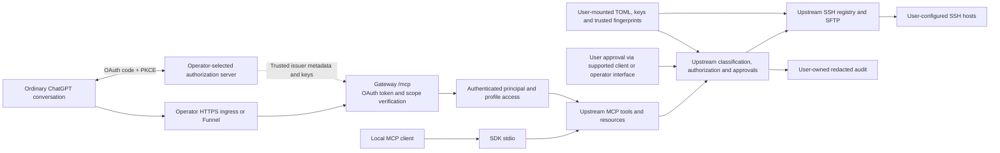

# Phase 1 repository audit and architecture

## Baselines

Reviewed November 23, 2026. Both remote default branches were queried with `git ls-remote --symref`. The complete tracked trees were enumerated with `git ls-tree -r --name-only`. Their common ancestor is `463d25fee532990be75794afd674523eac423321`.

| Baseline | Version | Commit | Tracked files |
| --- | --- | --- | ---: |
| [Original upstream](https://github.com/tufantunc/ssh-mcp/tree/5df4290df6826cc88c6e200c30a9a2238b63d05b) | 2.28.0 | `5df4290` | 313 |
| [ChatGPT reference](https://github.com/ZeroPointSix/ssh-mcp-chatgpt/tree/e2ed9df8c4934aaee96adef199bb767936b70318) | 1.6.9, HTTP reports 1.6.9-chatgpt.0 | `e2ed9df` | 44 |
| Local merge checkpoint | 2.28.0, HTTP reports 2.28.0-chatgpt.0 | `960337e` | 342 |

Upstream has modular source directories for configuration, policy, approvals and redaction, SSH, tools and resources, audit, observability, and HTTP transport. It includes unit, property, integration, differential, and E2E tests, Linux SSH fixtures, an MCP registry manifest, security documentation, and release automation. The reference fork has four source files, a flat test tree, a ChatGPT OAuth deployment guide, and host-specific operational files. The local merge retains both execution stacks. Its shared dependency upgrade and prior smoke test establish a baseline for migration. Each stack's authorization remains independent at that checkpoint.

## Behavior comparison

| Area | Upstream v2 | ChatGPT reference | Migration implication |
| --- | --- | --- | --- |
| SSH | Registry and connection lifecycle, host-key verification, bastions, compatibility layers, managed channels and SFTP | Dedicated pool, shell and SFTP workflows, separate background job and cancellation machinery | Use v2 profile, session, transfer and connection APIs end to end |
| Tools and resources | 16 registered tools across discovery, read and shell commands, approvals, sessions, signaling, SFTP and config reload. Three resource registrations | `health`, `list-profiles`, `exec`, `sudo-exec`, `exec-status`, `exec-cancel`, `fs-read`, `fs-write`, `fs-edit`, `run-script` | Expose actual v2 tools and schemas. Document behavior differences and replacements |
| Configuration and credentials | Owner-protected TOML, named profiles, role and host group bindings, limits, and transactional reload. SSH agent, mounted key or cert, passphrase, OS keychain and environment | Environment settings plus JSON profiles and default selection. SSH password, inline key or key path, and sudo options | Migrate explicitly to TOML and keep credentials in user-owned secret sources. Avoid automatic JSON fallback |
| MCP transports | SDK stdio and SDK stateful Streamable HTTP. Default HTTP bind is loopback, route is `/`, and auth uses static bearer. Session limits, idle cleanup, host validation and optional trusted proxy support | Hand-built JSON-RPC router at `/mcp` and an SSE probe. Initialization hardcodes 2024-11-05 | Use version-appropriate SDK transport and a canonical `/mcp` route. Preserve stdio and existing upstream HTTP invocation |
| Authentication | Upstream bearer gates HTTP. Credential resolution is separate from MCP transport | OAuth metadata, registration, a shared login secret, authorization code and PKCE, long-lived in-memory tokens and optional static bearer | Reuse the discovery and metadata contract. Delegate issuance to an operator-selected provider and enforce token validation at the resource server |
| Command authorization | Classifier, read-only mode, role and tier bindings, deny rules, quotas and optional OPA | Host selection, command length and sudo toggles, path checks for dedicated file tools | Make the upstream authorization pipeline mandatory on every remote SSH operation |
| Approvals | `ask-destructive` default, `ask-all`, `deny`, explicit `client-tool` and `auto`, with audited gate outcomes and optional grants | OAuth grants access to protected tools. No upstream per-command approval pipeline | Keep upstream approvals for compatible clients. Remote approval needs a verified human decision and a fail-closed server-side check |
| Audit and output | Per-operation decisions, approver, results and policy effects with redaction, rotation, optional chain integrity and bounded output | Redacted tool argument JSONL associated with the provided MCP session ID | Keep upstream audit and redaction, add minimal verified principal attribution. Verify redaction at response and transport log boundaries |
| Deployment | Node 22 slim image with non-root UID 65532, CLI entry point, compose for test fixtures and stdio app | Node 20 slim HTTP image with root default and no production health check | Carry the upstream non-root baseline into the production image and add real readiness, bounded shutdown, mounts and release workflow |

Upstream's local path and process tools assume a trusted local MCP client. For example, profile discovery includes account and host details, and reload has its own audit handling outside the SSH policy pipeline. Review the OAuth-side access gate for resources, profile listing, every session operation, local file transfers and reload. Approval modes, credential selection and effective role remain operator configuration. [Upstream tool registry](https://github.com/tufantunc/ssh-mcp/blob/5df4290/src/tools/registry.ts) · [Upstream policy pipeline](https://github.com/tufantunc/ssh-mcp/blob/5df4290/src/tools/pipeline.ts) · [Reference HTTP entry point](https://github.com/ZeroPointSix/ssh-mcp-chatgpt/blob/e2ed9df/src/chatgpt-http.ts)

## Dependency and protocol compatibility

The versions below are resolved from each tracked lockfile.

| Dependency | ChatGPT reference | Upstream v2 | Decision |
| --- | --- | --- | --- |
| Node.js | Declared ≥18, CI and image Node 20 | Declared ^18.19.0 or ≥20.6.0, CI and image Node 22 | Test and package on Node 22 initially. Keep stdio support within upstream's declared runtime range where the verified runtime dependencies permit |
| TypeScript | 5.9.2 | 5.9.3 | Use upstream ESM and Node16 module resolution and explicit extensions |
| MCP SDK | 1.17.5 | 1.32.2 | Keep one SDK baseline for the core. Use SDK server capabilities in constructor options. Avoid a second manual JSON-RPC stack |
| Zod | 3.23.8 | 4.6.7 | Use the upstream version and real tool schema/argument regression tests. The old private `_parse` assertion is obsolete |
| ssh2 | 1.17.0 | 1.17.0 | Keep upstream SSH wrapper and cipher handling, including the JavaScript implementation used in the container |
| Vitest and cross-env | 3.2.4 and 7.0.3 | 5.0.5 and 10.1.0 | Keep upstream scripts and test partitions |
| TOML and keychain | Absent | smol-toml 1.9.1 and optional keyring 2.1.2 | Keep upstream loader and credential resolver. Keychain support in a container depends on the runtime environment |
| Other | tsx, ts-node, Testcontainers | OpenTelemetry, Changesets, fast-check and Compose SSH fixtures | Use the upstream stack. Audit any auth dependency before introducing it. Retire legacy development dependencies when their entry points are removed |

SDK 1.32.2 reports support through protocol 2025-11-25. The official 2026-07-28 transport changes lifecycle and request metadata and removes HTTP transport sessions. Upstream already records its migration surface. For Phase 3, capture the protocol used by the actual ChatGPT client and run interoperability tests for the supported revisions. If that client requires 2026-07-28, use a compatible SDK and its transport with independent SSH session ownership. Do not claim newer compatibility based on the package version or an older MCP client. Preserve form elicitation for supported clients, and account for the different interaction flow in newer revisions. The project test harness includes a child-process flag removed in Node 26, so previous verification used Node 22. [MCP transport specification](https://modelcontextprotocol.io/specification/2026-07-28/basic/transports) · [Upstream migration notes](https://github.com/tufantunc/ssh-mcp/blob/5df4290/docs/mcp-2026-07-28-migration-surface.md)

## Target architecture

### Trust boundaries and security decisions

- Each operator owns their gateway, OAuth provider configuration, profiles, keys, fingerprint pins and audit data. The initial deployment supports an explicitly configured owner identity per instance. Validate issuer, subject, audience or resource, expiry and scopes on every protected HTTP request. Apply a profile allowlist where the owner exposes only a subset of configured hosts. Use authenticated ownership for HTTP and SSH session operations, and reject stale or mismatched identity after revocation or policy changes. Keep the default listener private. Terminate HTTPS via the operator's ingress and trust forwarding headers only from explicitly configured proxies. [OpenAI authentication reference](https://developers.openai.com/plugins/build/auth) · [MCP authorization specification](https://modelcontextprotocol.io/specification/2026-07-28/basic/authorization)
- Expose discovery metadata for a configured canonical HTTPS URL. Publish SDK-compatible per-tool OAuth metadata and accurate read, write and destructive annotations. Use an established authorization provider with S256 PKCE and an exact ChatGPT callback. Prefer supported CIMD, with DCR or pre-registered clients as interoperability options. Favor short-lived, revocable or introspectable credentials and define a tested revocation bound, including cleanup of active gateway sessions. [OpenAI authentication reference](https://developers.openai.com/plugins/build/auth)
- Remote defaults use dedicated non-root SSH users, strict verification with operator-provided host trust, narrowly scoped profiles, bounded output and sessions, and deny privileged execution absent an explicit role and approval configuration. Keep authorized commands on the v2 pipeline. Keep prompt-like text in SSH output as untrusted data. Operator-facing controls and existing client-independent authorization determine access.
- Keep request approval in the upstream policy pipeline. Verify ChatGPT's elicitation behavior in an ordinary conversation. When the client cannot present the required confirmation, deny the action unless a gateway-side operator approval is available. A possible gateway-side approval binds an explicit authenticated decision to the principal, profile, exact operation and arguments, expiry and policy revision. Consume it once and recheck policy at execution. Do not use an OAuth login, an annotation, an always-allow client preference, or upstream `client-tool` mode as the remote approval proof. [Upstream approval code](https://github.com/tufantunc/ssh-mcp/blob/5df4290/src/guard/elicitation.ts)
- The reference has transferable ChatGPT discovery, PKCE sequence, tool metadata, health and reverse-proxy setup concepts. Do not retain its execution pool, filesystem tools or JSON profile loader. Its token check only enforces token presence and expiry for OAuth tokens, while its router independently accepts a supplied MCP session ID. Host-derived public URLs, redirect-prefix matching, shared interactive login, and 365-day tokens must be replaced by the decisions above before public exposure.

## Migration plan

1. **Core baseline.** Start from the audited upstream revision via local merge checkpoint `960337e`. Make the upstream v2 core the sole supported product execution path. Identify and retire the duplicate implementations and deployment entry points. Preserve CLI behavior, schemas and configuration contracts, and prove stdio and v2 HTTP tool parity and tests before beginning the OAuth integration. Archive or document any legacy tooling that users must migrate from.
2. **Configuration and tool migration.** Map each legacy JSON profile to a named TOML entry with a role, group, credential reference and trusted host key. Require explicit choices for sudo, writable targets, allowed paths and approval. Map `list-profiles` to `list-connections`, `exec` to `read-command` or `run-command`, `sudo-exec` to `privileged-command`, and background status and cancellation to the upstream session tools. Map compatible file operations to SFTP. The fork's exact-match edits, integrity and backup responses, and script staging, syntax and incremental polling APIs have no direct equivalent. Document the differences without reintroducing a competing execution path.
3. **Remote connection.** Add an authenticated transport mode that constructs the same upstream tools once per SDK lifecycle as required by the verified protocol. Keep auth and deployment settings separate from SSH policy. Scope discovery and profile operation to the configured owner, protect administrative operations, and integrate human approval while retaining upstream rechecks. Verify the real ChatGPT protocol before choosing a newer SDK or adapter. Keep the private service unavailable to ChatGPT until the approved remote verification can begin.
4. **Validation and packaging.** Verify the local security and functionality matrix before building a non-root, minimal production container. Publish versioned images via CI and prove a fresh install on a second authorized machine. Add private Serve and public Funnel deployment configurations with persistent Tailscale state and OAuth protection. Exercise ordinary ChatGPT, approvals, restarts, revocation and reauthorization. [Tailscale Docker](https://tailscale.com/docs/features/containers/docker) · [Tailscale Funnel](https://tailscale.com/docs/features/tailscale-funnel)
5. **Review readiness.** Use only an isolated, restricted, non-production reviewer fixture and synthetic data for any future submission. Prepare data and privacy documentation, tool annotations and justifications, a publicly reachable review endpoint, domain verification, reviewer login and reproducible test prompts. Review eligibility for general-purpose SSH and owner-specific endpoints with OpenAI before any submission. Passing custom app and self-hosting tests does not establish directory approval. [OpenAI remote MCP review requirements](https://developers.openai.com/plugins/deploy/app-review) · [OpenAI submission process](https://developers.openai.com/plugins/deploy/submission)

## Preservation checklist

- Upstream stdio, bearer HTTP, v2 tool names and schemas, resources, structured error outcomes and version reporting.
- TOML profile resolution, role and tier bindings, read-only guarantees, classifier, denylist, never-allowed operations, quotas, OPA when configured, approvals and approval-grant invalidation.
- Strict host-key verification and supported local trust modes, bastion routes, SSH agent, user-mounted keys and certificates, passphrases, environment and keychain resolution.
- SSH commands, persistent and background sessions, cancellation and accurate terminal status, lifecycle cleanup, concurrency limits, output bounds, OpenSSH and alternate peers, and SFTP constraints.
- Audit decisions and effects, approver, redaction, rotation and optional integrity chain. Configuration validation and safe reload.
- ChatGPT HTTP endpoint, OAuth discovery, per-tool auth information and health metadata with no host, path or credential leakage to anonymous callers.

## Phase 1 evidence and open items

- Snapshot checks confirmed both published default-branch heads, lockfile versions and source directories. The locally installed SDK protocol list and the upstream migration notes establish the protocol compatibility gap. No implementation changes were made during Phase 1.
- Prior checkpoint evidence for `960337e` recorded Node 22 build, typecheck and package checks, plus 5,170 passed, 0 failed, 29 skipped against local OpenSSH and Dropbear fixtures. A separate local OAuth/PKCE smoke succeeded against the legacy connector. The earlier Docker runtime attempt failed at the host's cgroup/BPF device setup. This evidence covers the merge baseline only.
- Phase 2 must demonstrate the sole v2 execution path and new core test evidence. ChatGPT protocol and elicitation behavior, operator approval fallback, remote OAuth revocation, production Docker and Funnel, a separate authorized test machine, and public submission feasibility still require verification.
- Phase 3 includes ordinary ChatGPT connection proof. Public-network deployment and second-machine proof are repeated at the formal Phase 6 and Phase 7 gates. Before taking on Phase 3, confirm access to an approved temporary HTTPS test route and the intended ChatGPT account or arrange access with the operator. Keep the Phase 3 gate open until the conversation test succeeds.
